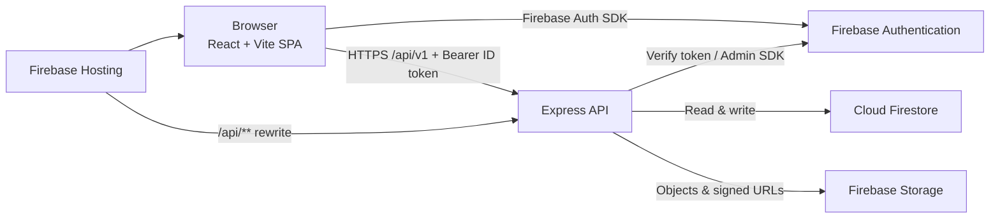

<div align="center">

# Unified Workspace

**A single team platform for real-time conversation, visual project planning, and structured issue delivery with connected cross-module workflows.**

Built with **React**, **Vite**, **Chakra UI**, **Tailwind CSS**, **Express**, **Firebase Authentication**, and **Cloud Firestore**.

<p>
  
  
  
  
  
  
  
  
  
  
  
  
  
  
</p>

<p>
  <a href="#features">Features</a> · <a href="#quick-start">Quick Start</a> · <a href="#architecture">Architecture</a> · <a href="#data-model">Data Model</a> · <a href="#deployment">Deployment</a>
</p>

</div>

## Table of Contents

- [Features](#features)
- [Technology Stack](#technology-stack)
- [Architecture](#architecture)
- [Data Model](#data-model)
- [Project Structure](#project-structure)
- [Requirements](#requirements)
- [Quick Start](#quick-start)
- [Environment Variables](#environment-variables)
- [Firebase Setup](#firebase-setup)
- [Security Rules](#security-rules)
- [Available Scripts](#available-scripts)
- [Usage Guide](#usage-guide)
- [Testing](#testing)
- [Deployment](#deployment)
- [Roadmap](#roadmap)
- [Contributing](#contributing)
- [License](#license)

## Features

### Communication (Slack-style)
- Workspace-scoped channels and direct/group conversation foundations.
- Message creation, editing, deletion, reactions, and attachment routes.
- Real-time-friendly data model with channel membership and message collections.

### Boards (Trello-style)
- Boards, ordered lists, and cards with drag-and-drop-oriented positioning fields.
- Card placement linked to work items through `issueId`.
- Board/list/card API modules with authenticated access control.

### Issues (Jira-style)
- Canonical issue records with type, status, priority, assignee, reporter, labels, and due dates.
- Issue comments, saved views, sprint foundations, and project-scoped queries.
- Workflow/status updates managed through backend services.

### Cross-Module Integration
- Convert a channel message into an issue (`POST /api/v1/integrations/messages/:channelId/:messageId/convert-to-issue`).
- Create a board card from an issue (`POST /api/v1/integrations/boards/:boardId/issues/:issueId/create-card`).
- Synchronize card/issue state (`POST /api/v1/integrations/boards/:boardId/cards/:cardId/issues/:issueId/sync`).

### Dashboard, Notifications, and Productivity
- Authenticated routes for overview, projects, boards, issues, channels, notifications, productivity, and search.
- Notification and activity modules for in-app event tracking.
- Workspace analytics and search API endpoints for operational visibility.

## Technology Stack

| Layer | Technology | Purpose |
|---|---|---|
| Frontend UI | React 19, JSX | Component-based SPA |
| Build tooling | Vite 8 | Dev server and production bundling |
| Routing | React Router 7 | Client-side navigation and protected routes |
| UI system | Chakra UI 2, Tailwind CSS 4, Lucide React | Accessible primitives, utility styling, icons |
| Server state | TanStack Query 5 | API caching and request lifecycle |
| Drag and drop | @dnd-kit | Kanban interaction foundations |
| Backend API | Express 4 (Node.js, ES Modules) | REST API under `/api/v1` |
| Identity | Firebase Authentication | User sign-in and ID token verification |
| Data | Cloud Firestore | Primary application database |
| Files/push | Firebase Storage, Cloud Messaging | Attachments and browser push foundations |
| Validation/security | Zod, Helmet, CORS, express-rate-limit | Input validation and HTTP hardening |
| Testing | Vitest, Supertest, React Testing Library | Unit/integration/component testing |

## Architecture

The frontend is a React SPA that authenticates with Firebase and sends the Firebase ID token to the Express API. The API verifies tokens with Firebase Admin, applies authorization checks, and performs Firestore operations. Firebase Hosting can serve the SPA and rewrite `/api/**` to the backend service.



The SPA uses `src/services/apiClient.js` for backend calls; UI components should not bypass the API for protected business operations.

## Data Model

The backend uses Firestore as the primary store. Collections and access patterns are implemented across module repositories; the client does not access Firestore directly.

<details>
<summary><strong>Identity and tenancy</strong></summary>

| Collection / Path | Purpose | Key fields |
|---|---|---|
| `users` | User profile records synchronized from auth | `uid`, profile fields, timestamps |
| `workspaces` | Workspace/tenant container | `name`, settings, ownership metadata |
| `workspaces/{workspaceId}/members/{userId}` | Workspace membership and role | `role`, join metadata |
| `invitations` | Workspace/project invitation state | `token`, target, status, expiry |

</details>

<details>
<summary><strong>Projects and delivery</strong></summary>

| Collection / Path | Purpose | Key fields |
|---|---|---|
| `projects` | Project scoped to a workspace | `workspaceId`, `name`, `key`, `visibility`, `status` |
| `projects/{projectId}/members/{userId}` | Project membership | `role`, `addedBy` |
| `issues` | Canonical work item | `workspaceId`, `projectId`, `title`, `type`, `status`, `priority`, `assigneeId`, `reporterId` |
| `issues/{issueId}/comments/*` (module-dependent) | Issue discussion/history | `authorId`, `body`, timestamps |
| `sprints` / sprint foundations | Sprint planning data | project/workspace scope, dates, goals |

</details>

<details>
<summary><strong>Communication and boards</strong></summary>

| Collection / Path | Purpose | Key fields |
|---|---|---|
| `channels` | Chat channels/conversations metadata | `workspaceId`, `name`, visibility/type |
| `channels/{channelId}/members/*` | Channel membership | `userId`, role/state |
| `channels/{channelId}/messages/*` | Messages | `senderId`, `content`, timestamps, edit/attachment refs |
| `channels/{channelId}/messages/{messageId}/reactions/*` | Reactions | emoji/type, actor |
| `boards` | Kanban boards | `workspaceId`, `projectId`, metadata |
| `boards/{boardId}/lists/*` | Ordered board columns | `name`, `position` |
| `boards/{boardId}/cards/*` | Board cards referencing issues | `issueId`, `listId`, `position` |

</details>

<details>
<summary><strong>System records</strong></summary>

| Collection / Path | Purpose | Key fields |
|---|---|---|
| `notifications` / user-scoped notifications | In-app notification delivery | recipient, type, read state |
| `activities` | Audit/activity feed events | actor, action, resource, context |
| attachments metadata | File metadata linked to resources | storage path, owner, resource ref |

</details>

Issues are the canonical work record. Board cards reference issues via `issueId`; integration endpoints synchronize issue and board state.

## Project Structure

```text
WorkStation/
├── Backend/                  # Express API (ES Modules)
│   ├── src/
│   │   ├── config/           # Firebase Admin, env, CORS
│   │   ├── middleware/       # Auth, validation, rate limits, errors
│   │   ├── modules/          # Feature modules (routes/controllers/services/repos)
│   │   ├── routes/           # /api/health and /api/v1 router mount
│   │   ├── shared/           # Errors, constants, services, utilities
│   │   ├── app.js            # Express app factory
│   │   └── server.js         # Server entrypoint
│   ├── tests/                # Backend tests
│   ├── .env.example          # Backend environment template
│   └── package.json
├── Frontend/                 # React + Vite SPA
│   ├── src/
│   │   ├── components/       # Shared UI/navigation/feedback
│   │   ├── contexts/         # Auth/workspace context providers
│   │   ├── features/         # Feature screens (auth, dashboard, projects, etc.)
│   │   ├── layouts/          # App shell layouts
│   │   ├── lib/              # Firebase client, query client
│   │   ├── routes/           # Route definitions and guards
│   │   ├── services/         # API client
│   │   ├── theme/            # Chakra/theme configuration
│   │   ├── workstation/      # Demo workspace modules and local state
│   │   ├── App.jsx           # App composition
│   │   └── main.jsx          # SPA entrypoint
│   ├── .env.example          # Frontend environment template
│   └── package.json
├── docs/                     # API, database, deployment, handover notes
├── firebase.json             # Hosting, rules, emulator config
├── firestore.rules           # Firestore security rules (deny client access)
├── firestore.indexes.json    # Firestore indexes
├── storage.rules             # Storage security rules (deny client access)
└── README.md
```

## Requirements

- Node.js 22.x and npm 10+.
- A Firebase project with Authentication, Firestore, and (for production) Storage/Hosting/FCM as needed.
- Firebase CLI (`npm install -g firebase-tools`) for emulator, rules, and Hosting workflows.
- Google Cloud CLI (`gcloud`) for Cloud Run deployment (production).

## Quick Start

1. Clone the repository and install dependencies:

```bash
git clone <your-repository-url>
cd WorkStation
npm --prefix Backend install
npm --prefix Frontend install
```

2. Create local environment files:

```bash
cp Backend/.env.example Backend/.env
cp Frontend/.env.example Frontend/.env.local
```

3. Fill in Firebase web app values in `Frontend/.env.local`. For local API + emulator development, keep:

```bash
# Backend/.env
FIREBASE_USE_EMULATOR=true
PORT=4000

# Frontend/.env.local
VITE_USE_FIREBASE_EMULATOR=false
VITE_API_BASE=/api/v1
```

4. Start the backend API:

```bash
cd Backend
npm run dev
```

5. In a second terminal, start the frontend:

```bash
cd Frontend
npm run dev
```

6. Open `http://localhost:5173`. The Vite dev server proxies `/api/*` to `http://localhost:4000`.

Optional: start Firebase emulators when you want local Firebase services:

```bash
firebase emulators:start
```

## Environment Variables

### Frontend (`Frontend/.env.local`)

| Variable | Required | Description |
|---|---|---|
| `VITE_FIREBASE_API_KEY` | Yes (non-demo auth flow) | Firebase web API key (public client config). |
| `VITE_FIREBASE_AUTH_DOMAIN` | Yes | Firebase Auth domain. |
| `VITE_FIREBASE_PROJECT_ID` | Yes | Firebase project ID. |
| `VITE_FIREBASE_STORAGE_BUCKET` | Yes | Firebase Storage bucket. |
| `VITE_FIREBASE_MESSAGING_SENDER_ID` | Yes | Firebase messaging sender ID. |
| `VITE_FIREBASE_APP_ID` | Yes | Firebase web app ID. |
| `VITE_FIREBASE_VAPID_KEY` | No | Web Push certificate key for FCM browser notifications. |
| `VITE_USE_FIREBASE_EMULATOR` | No | Use Firebase client emulators in local development. |
| `VITE_API_BASE` | No | API base path/URL; default `/api/v1`. |

### Backend (`Backend/.env`)

| Variable | Required | Description |
|---|---|---|
| `PORT` | No | Express listen port (default `4000`). |
| `NODE_ENV` | No | Runtime environment (`development`, `production`). |
| `API_VERSION` | No | API prefix version (default `v1`). |
| `CORS_ORIGINS` | No | Comma-separated allowed origins. |
| `FIREBASE_USE_EMULATOR` | No | Enable Firebase Admin emulator mode. |
| `FIRESTORE_EMULATOR_HOST` | No | Firestore emulator host when enabled. |
| `FIREBASE_AUTH_EMULATOR_HOST` | No | Auth emulator host when enabled. |
| `FIREBASE_PROJECT_ID` | Production/ADC setups | Firebase/Google Cloud project ID. |
| `FIREBASE_STORAGE_BUCKET` | When using Storage | Storage bucket name. |
| `TRUST_PROXY` | Cloud Run/proxy | Trust proxy hop for real client IP/rate limiting. |
| `RATE_LIMIT_*`, `AUTH_TOKEN_CACHE_MS`, `LOG_LEVEL` | No | Operational tuning values. |

Never commit real service-account keys or secrets. Do not place server secrets in `VITE_*` variables.

## Firebase Setup

1. Create or select a Firebase project (current config references `workshop-111f1`).
2. Enable **Authentication** (Email/Password for the current auth flow).
3. Create a **Cloud Firestore** database (Native mode).
4. Enable **Storage** and **Cloud Messaging** if you use attachments/push notifications.
5. Register a Web App and copy client config values into `Frontend/.env.local`.
6. For production Admin SDK access, use Application Default Credentials (Cloud Run service account) or approved local ADC; do not store private keys in the repository.
7. Deploy rules/indexes when ready:

```bash
firebase deploy --only firestore:rules,firestore:indexes,storage
```

## Security Rules

The repository includes deny-by-default client rules:

- `firestore.rules`: denies all direct client reads/writes (`allow read, write: if false`).
- `storage.rules`: denies all direct client object access.

This matches the API-mediated architecture: the React app authenticates with Firebase, calls the Express API with an ID token, and the backend enforces authorization before using Firebase Admin. Re-enabling direct client access requires a full per-collection/per-path rules design and test suite.

## Available Scripts

### Root
- Firebase CLI commands are run from the repository root (`firebase.json` is here).

### Backend (`Backend/package.json`)

| Command | Description |
|---|---|
| `npm run dev` | Start API with Node watch mode. |
| `npm start` | Start API once. |
| `npm run lint` | Run ESLint on `src`. |
| `npm test` | Run Vitest (`vitest run`). |
| `npm run test:watch` | Run Vitest in watch mode. |

### Frontend (`Frontend/package.json`)

| Command | Description |
|---|---|
| `npm run dev` | Start Vite dev server. |
| `npm run build` | Build production assets to `dist/`. |
| `npm run preview` | Preview the production build locally. |
| `npm run lint` | Run ESLint. |
| `npm test` | Run Vitest (`vitest run`). |
| `npm run test:watch` | Run Vitest in watch mode. |

## Usage Guide

1. **Sign in/register:** use `/login` or `/register`. The frontend obtains a Firebase ID token and calls protected API routes.
2. **Select/create workspace context:** workspace membership determines visible projects and actions.
3. **Create a project:** open Overview or Projects and submit the project form (requires a permitted workspace role).
4. **Track work:** create/manage issues through the Issues module and related API endpoints.
5. **Plan visually:** use Boards for list/card organization; cards are designed to reference canonical issues.
6. **Collaborate:** use Channels for conversation and integration endpoints to connect messages, issues, and board cards.
7. **Monitor:** review notifications, activity, productivity, and search surfaces as they are enabled for your workspace.

API routes are served under `/api/v1` (for example, `/api/v1/projects`, `/api/v1/issues`, `/api/v1/channels`). Health endpoints are exposed under `/api/health*`.

## Testing

Current automated test tooling is configured with Vitest in both apps:

```bash
cd Backend && npm test
cd Frontend && npm test
```

Useful checks:

```bash
cd Backend && npm run lint
cd Frontend && npm run lint
cd Frontend && npm run build
```

The platform has route/service/component test foundations in places, but test coverage is not yet comprehensive across all modules, rules, and end-to-end flows. Treat production readiness as dependent on expanding integration, rules, and workflow tests.

## Deployment

The intended production shape is **Firebase Hosting** for the SPA and **Cloud Run** for the Express API, with Hosting rewriting `/api/**` to the Cloud Run service (`workstation-api`, `us-central1` per `firebase.json`).

High-level flow:

```bash
# 1. Build frontend
cd Frontend
npm ci
npm run build

# 2. Deploy Firebase rules/indexes and Hosting (from repo root)
cd ..
firebase deploy --only firestore:rules,firestore:indexes,storage,hosting
```

Deploy the backend container to Cloud Run using your Google Cloud build/deploy pipeline (see `docs/DEPLOYMENT.md` for detailed `gcloud` and service-account setup). Configure production CORS, `TRUST_PROXY`, Firebase project settings, and Hosting rewrites to match the deployed API service.

Production checklist:
- Set production Firebase web config and API base.
- Use ADC/service account permissions; no keys in source control.
- Enable required Firebase/Google APIs and billing.
- Verify auth, rules, storage, and CORS behavior.
- Confirm Cloud Run health, logs, and rate limits.

## Roadmap

- Complete end-to-end UI coverage for every backend module (channels/messages, boards DnD sync, issues workflows, invitations).
- Add comprehensive API integration tests and Firebase rules unit tests.
- Harden notification delivery (FCM device registration, preferences, deduplication).
- Implement full Firestore indexes and production observability dashboards.
- Add CI/CD pipelines for lint, test, build, rules checks, and staged deploys.
- Provide curated screenshots in `docs/screenshots/` once UI states are stable.

## Contributing

1. Create a focused branch for the change.
2. Keep backend logic in `Backend/` and frontend logic in `Frontend/`.
3. Run relevant lint/tests/build commands before opening a pull request.
4. Update documentation when routes, environment variables, data models, or deployment behavior changes.
5. Do not commit secrets, service-account keys, or populated `.env` files.

## License

ISC (see `Backend/package.json`). Add or update a root `LICENSE` file if the project adopts a different repository-wide license.

---

Matches README reference? Deviations: README follows the requested centered header/badge-wall/quick-jump/ToC structure and required section order, but does not include screenshots because `docs/screenshots/` assets are not present; technology badge versions/labels are aligned to this repository (`React 19`, `Vite 8`, `Tailwind 4`, `Express 4`) rather than the sample values in the design text. All documented commands/config paths reflect the current codebase.
